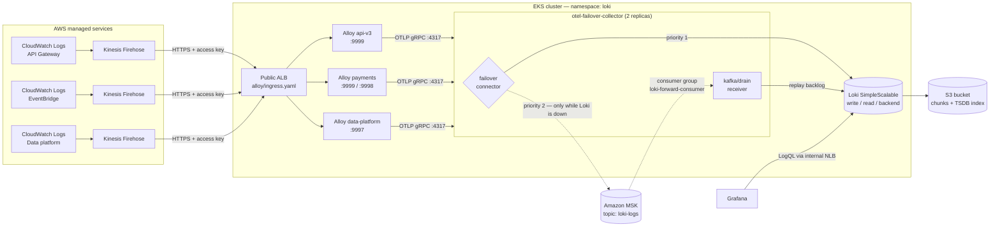

# loki-otel-kafka-failover-logging


A production-style **centralized logging platform on AWS EKS** that I designed and built:

- **Grafana Loki** (Simple Scalable mode, S3 + TSDB) as the log store.
- **Grafana Alloy** collectors that receive **AWS CloudWatch logs via Kinesis Firehose**, then parse and label them.
- An **OpenTelemetry Collector** "failover hub". It sends logs to Loki first, **diverts them to Amazon MSK (Kafka) when Loki is down**, and **replays the buffer back into Loki** when Loki recovers. **No logs are lost during a Loki outage.**

---

## Table of contents

1. [What problem does this solve?](#what-problem-does-this-solve)
2. [Tools & AWS resources used](#tools--aws-resources-used)
3. [Architecture](#architecture)
4. [Repository layout](#repository-layout)
5. [Prerequisites](#prerequisites)
6. [Values you must replace](#values-you-must-replace)
7. [Build it from scratch (step by step)](#build-it-from-scratch-step-by-step)
8. [Verify end-to-end](#verify-end-to-end)
9. [Behind the stage: how each piece works](#behind-the-stage-how-each-piece-works)
10. [Key design decisions](#key-design-decisions)
11. [Troubleshooting](#troubleshooting)
12. [What I'd add next](#what-id-add-next)

---

## What problem does this solve?

Before this project, logs went to a **single-replica Loki 2.2 StatefulSet** on an EFS volume ([`legacy/`](legacy/loki-single-binary-v2.2.yaml)). That setup had three problems:

- **No high availability.** Every Loki restart or upgrade meant an ingestion outage.
- **Logs were dropped.** If Loki was down, logs pushed to it were simply lost.
- **No AWS-native ingestion.** API Gateway, EventBridge and data-platform logs sat in CloudWatch and could not be searched next to application logs in Grafana.

This project replaces that setup with:

| Goal | How it is achieved |
|---|---|
| Scalable, HA log store | Loki **SimpleScalable** (3 write / 5 read / 4 backend), chunks + index in **S3**, **TSDB schema v13**, memcached caches |
| Pull AWS-managed logs in | CloudWatch Logs → **Kinesis Firehose** → **Grafana Alloy** (`loki.source.awsfirehose`) over HTTPS through an ALB |
| Zero log loss during Loki outages | **OpenTelemetry `failover` connector**: Loki is priority 1, **MSK Kafka** is priority 2. A separate drain pipeline replays Kafka into Loki with **at-least-once** offset commits |
| Low-cardinality, cheap index | Only `service.name`, `app`, `env` (and the optional `via`) are index labels. Everything else becomes **structured metadata** through Loki's native **OTLP** ingest |
| No static credentials | **IRSA** for S3 and MSK (IAM auth); the Firehose shared secrets come from a Kubernetes **Secret** |

---

## Tools & AWS resources used

- **Kubernetes:** Amazon EKS, Helm, AWS Load Balancer Controller (ALB + NLB), IRSA (IAM Roles for Service Accounts)
- **Logging:** Grafana Loki (Helm chart `grafana/loki`), Grafana Alloy (Helm chart `grafana/alloy`), Loki Canary
- **Pipeline:** OpenTelemetry Collector **contrib** `0.128.0` (`otlp` receiver, `failover` connector, `kafka` receiver/exporter, `otlphttp` exporter)
- **AWS:** S3, Amazon MSK (Kafka, IAM auth on port 9098), Kinesis Data Firehose (HTTP endpoint destination), CloudWatch Logs subscription filters, ACM certificates, IAM
- **Observability of the pipeline itself:** Prometheus scrape annotations on the collector (`:8888`) and the canary (`:3500`); the Loki ruler remote-writes recorded metrics to Prometheus and sends alerts to Alertmanager

---

## Architecture



**The three runtime scenarios** (full detail in [`docs/kafka-failover.md`](docs/kafka-failover.md)):

| Scenario | What happens |
|---|---|
| **Loki healthy** | Alloy → hub → `otlphttp/loki-live` → Loki. Kafka is idle. |
| **Loki down** | `loki-live` fails for 30s → the failover connector switches to `kafka/msk` → logs pile up in `loki-logs`. The drain path cannot push to Loki, so it **does not commit offsets** and the data stays in Kafka. |
| **Loki recovers** | The drain pushes the backlog with its **original timestamps** and commits offsets, so lag falls to 0. Within 1 min the connector fails back to the live path. |

---

## Repository layout

```
.
├── loki/
│   └── values.yaml                     # Loki Helm values: SimpleScalable, S3/TSDB, OTLP label promotion, ruler, caches
├── alloy/
│   ├── alloy-api-v3.yaml               # Alloy: API Gateway access + execution log parsing (regex/json/match stages)
│   ├── alloy-payments.yaml             # Alloy: two Firehose inputs (API GW + EventBridge), two service identities
│   ├── alloy-data-platform.yaml        # Alloy: data-platform logs
│   └── ingress.yaml                    # Public ALB, one hostname per Firehose endpoint
├── otel-collector/
│   └── otel-failover-collector.yaml    # SA + ConfigMap + Deployment + Service for the failover hub
├── k8s/
│   └── firehose-secret.example.yaml    # Template for the Firehose access-key Secret (no real values)
├── iam/
│   ├── loki-s3-policy.json             # S3 permissions for Loki (IRSA)
│   ├── msk-access-policy.json          # MSK produce + consume permissions for the hub (IRSA)
│   └── irsa-trust-policy.json          # Trust policy template for both roles
├── kafka/
│   └── create-topic.sh                 # Creates the loki-logs buffer topic on MSK (IAM auth)
├── scripts/
│   └── check-failover-metrics.sh       # Shows which path (live / kafka / drain) each hub pod is using
├── docs/
│   └── kafka-failover.md               # Deep dive: config that matters, scenarios, IAM, smoke test, troubleshooting
└── legacy/
    └── loki-single-binary-v2.2.yaml    # The original setup this project replaced (for reference only)
```

---

## Prerequisites

| Tool / resource | Why | Check |
|---|---|---|
| An **EKS cluster** (1.27+) with an **OIDC provider** | Pods assume IAM roles (IRSA) | `aws eks describe-cluster --name $CLUSTER --query cluster.identity.oidc.issuer` |
| **AWS Load Balancer Controller** | Creates the ALB (Firehose ingress) and NLB (Loki gateway) | `kubectl get deploy -n kube-system aws-load-balancer-controller` |
| `kubectl`, `helm` v3, `aws` CLI v2 | Deploying | `helm version` |
| An **ACM certificate** for your domain | HTTPS on the ALB / NLB | ACM console |
| A DNS zone you control (e.g. Route 53) | Hostnames for Firehose and Loki | |
| An **Amazon MSK** cluster with **IAM auth** enabled | Failover buffer | `aws kafka list-clusters-v2` |
| Kafka CLI + `aws-msk-iam-auth` jar (on a host inside the VPC) | Creating the topic | `kafka-topics.sh --version` |
| Basic knowledge of Kubernetes, Helm and AWS IAM | | |

Add the Helm repos once:

```bash
helm repo add grafana https://grafana.github.io/helm-charts
helm repo add eks https://aws.github.io/eks-charts
helm repo update
```

---

## Values you must replace

Every environment-specific value in this repo is a `<PLACEHOLDER>`. To list them all:

```bash
grep -rnoE '<[A-Z0-9_]+>' --include='*.yaml' --include='*.json' . | sort -u
```

| Placeholder | Example | Used in |
|---|---|---|
| `<AWS_ACCOUNT_ID>` | `123456789012` | `loki/values.yaml`, `otel-collector/`, `iam/` |
| `<AWS_REGION>` | `us-west-2` | `loki/values.yaml`, `otel-collector/`, `iam/` |
| `<LOKI_S3_BUCKET>` | `my-company-loki-logs` | `loki/values.yaml`, `iam/loki-s3-policy.json` |
| `<LOKI_S3_ROLE_NAME>` | `loki-s3-irsa` | `loki/values.yaml` |
| `<LOKI_KAFKA_ROLE_NAME>` | `loki-msk-irsa` | `otel-collector/otel-failover-collector.yaml` |
| `<MSK_CLUSTER_NAME>` | `loki-buffer` | `iam/msk-access-policy.json` |
| `<MSK_BROKER_1>`, `<MSK_BROKER_2>` | `b-1.xxx.kafka.us-west-2.amazonaws.com` | `otel-collector/otel-failover-collector.yaml` |
| `<EKS_OIDC_PROVIDER>` | `oidc.eks.us-west-2.amazonaws.com/id/ABC123` | `iam/irsa-trust-policy.json` |
| `<ACM_CERTIFICATE_ARN>` | `arn:aws:acm:...:certificate/...` | `loki/values.yaml`, `alloy/ingress.yaml` |
| `<PUBLIC_SUBNET_ID_1>`, `<PUBLIC_SUBNET_ID_2>` | `subnet-0abc...` | `alloy/ingress.yaml` |
| `<YOUR_DOMAIN>` | `example.com` | `loki/values.yaml`, `alloy/ingress.yaml` |

> 🔐 **Secrets are never stored in this repo.** The Firehose access keys are created with `kubectl create secret` (step 6), and AWS access comes from IRSA roles, not keys.

---

## Build it from scratch (step by step)

Set these once in your shell. Every command below uses them.

```bash
export CLUSTER=my-eks-cluster
export AWS_REGION=us-west-2
export ACCOUNT_ID=$(aws sts get-caller-identity --query Account --output text)
export OIDC=$(aws eks describe-cluster --name $CLUSTER --region $AWS_REGION \
  --query cluster.identity.oidc.issuer --output text | sed 's#https://##')
export LOKI_BUCKET=my-company-loki-logs
kubectl create namespace loki
```

### Step 1 — AWS Load Balancer Controller (skip if already installed)

```bash
helm upgrade --install aws-load-balancer-controller eks/aws-load-balancer-controller \
  -n kube-system --set clusterName=$CLUSTER \
  --set serviceAccount.create=false --set serviceAccount.name=aws-load-balancer-controller
```

(This needs its own IRSA role. See the [AWS docs](https://docs.aws.amazon.com/eks/latest/userguide/lbc-helm.html).)

### Step 2 — S3 bucket and IAM role for Loki

```bash
aws s3api create-bucket --bucket $LOKI_BUCKET --region $AWS_REGION \
  --create-bucket-configuration LocationConstraint=$AWS_REGION

# Trust policy: the Loki chart's ServiceAccount is named "loki"
sed -e "s#<AWS_ACCOUNT_ID>#$ACCOUNT_ID#g" -e "s#<EKS_OIDC_PROVIDER>#$OIDC#g" \
    -e "s#<SERVICE_ACCOUNT_NAME>#loki#g" iam/irsa-trust-policy.json > /tmp/loki-trust.json
sed "s#<LOKI_S3_BUCKET>#$LOKI_BUCKET#g" iam/loki-s3-policy.json > /tmp/loki-s3.json

aws iam create-role --role-name loki-s3-irsa --assume-role-policy-document file:///tmp/loki-trust.json
aws iam put-role-policy --role-name loki-s3-irsa --policy-name loki-s3 --policy-document file:///tmp/loki-s3.json
```

### Step 3 — Install Loki

Fill in the placeholders in `loki/values.yaml` (bucket, region, role ARN, ACM cert, domain), then:

```bash
helm upgrade --install loki grafana/loki -n loki -f loki/values.yaml
kubectl get pods -n loki -w      # wait for loki-write-*, loki-read-*, loki-backend-*, loki-gateway-* to be Ready
```

What you get:

- **write** pods (distributor + ingester) receive logs and flush chunks to S3.
- **read** pods (querier + query-frontend) answer Grafana queries.
- **backend** pods (compactor, index gateway, ruler, scheduler) handle retention (28 days), indexing and rules.
- A **gateway** (nginx) on an **internal NLB**, reachable only from `10.0.0.0/8`.

### Step 4 — MSK topic and IAM role for the failover hub

```bash
# 4a. Topic (run from a host/pod inside the VPC that can reach MSK)
export MSK_CLUSTER_ARN=arn:aws:kafka:$AWS_REGION:$ACCOUNT_ID:cluster/<name>/<id>
./kafka/create-topic.sh          # loki-logs, 6 partitions, RF=2, 24h retention

# 4b. IAM role for the collector's ServiceAccount
sed -e "s#<AWS_ACCOUNT_ID>#$ACCOUNT_ID#g" -e "s#<EKS_OIDC_PROVIDER>#$OIDC#g" \
    -e "s#<SERVICE_ACCOUNT_NAME>#otel-failover-collector#g" iam/irsa-trust-policy.json > /tmp/msk-trust.json
sed -e "s#<AWS_ACCOUNT_ID>#$ACCOUNT_ID#g" -e "s#<AWS_REGION>#$AWS_REGION#g" \
    -e "s#<MSK_CLUSTER_NAME>#<your-msk-cluster-name>#g" iam/msk-access-policy.json > /tmp/msk.json

aws iam create-role --role-name loki-msk-irsa --assume-role-policy-document file:///tmp/msk-trust.json
aws iam put-role-policy --role-name loki-msk-irsa --policy-name loki-msk --policy-document file:///tmp/msk.json
```

> ⚠️ `kafka-cluster:WriteDataIdempotently` **is required**. Without it, every produce fails with `CLUSTER_AUTHORIZATION_FAILED`.

### Step 5 — Deploy the OpenTelemetry failover hub

Fill in the broker addresses (`aws kafka get-bootstrap-brokers --cluster-arn $MSK_CLUSTER_ARN --query BootstrapBrokerStringSaslIam`), the region and the role ARN in `otel-collector/otel-failover-collector.yaml`, then:

```bash
kubectl apply -f otel-collector/otel-failover-collector.yaml
kubectl rollout status deploy/otel-failover-collector -n loki
```

The hub must be up **before** the Alloy producers, because they need somewhere to send.

### Step 6 — Firehose secret and Alloy producers

```bash
kubectl create secret generic alloy-firehose-access-keys -n loki \
  --from-literal=api-v3="$(openssl rand -hex 24)" \
  --from-literal=data-platform="$(openssl rand -hex 24)" \
  --from-literal=payments="$(openssl rand -hex 24)"

helm upgrade --install alloy-api-v3        grafana/alloy -n loki -f alloy/alloy-api-v3.yaml
helm upgrade --install alloy-payments      grafana/alloy -n loki -f alloy/alloy-payments.yaml
helm upgrade --install alloy-data-platform grafana/alloy -n loki -f alloy/alloy-data-platform.yaml
```

Keep the generated keys: Firehose needs the same values in step 8.
`kubectl get secret alloy-firehose-access-keys -n loki -o jsonpath='{.data.api-v3}' | base64 -d`

### Step 7 — Public ingress for Firehose

Fill in the subnets, certificate and domain in `alloy/ingress.yaml`, then:

```bash
kubectl apply -f alloy/ingress.yaml
kubectl get ingress -n loki alloy-firehose-ingress   # copy the ALB DNS name
```

Create a DNS **CNAME** for each host (`alloy-firehose-api-v3.<domain>`, and so on) that points to that ALB.

### Step 8 — Kinesis Firehose streams and CloudWatch subscriptions

For **each** log source, create a Firehose stream (Console → Kinesis Data Firehose → *Create*):

| Setting | Value |
|---|---|
| Source | Direct PUT |
| Destination | **HTTP Endpoint** |
| HTTP endpoint URL | `https://alloy-firehose-api-v3.<domain>/awsfirehose/api/v1/push` |
| Access key | the matching value from the Kubernetes Secret (step 6) |
| Content encoding | GZIP |
| S3 backup | *Failed data only* (any bucket); keeps whatever Alloy rejects |

Then point the CloudWatch log groups at the stream:

```bash
aws logs put-subscription-filter \
  --log-group-name "<API-Gateway-Execution-Logs_xxxx/stage>" \
  --filter-name to-loki --filter-pattern "" \
  --destination-arn arn:aws:firehose:$AWS_REGION:$ACCOUNT_ID:deliverystream/<stream-name> \
  --role-arn arn:aws:iam::$ACCOUNT_ID:role/<cwlogs-to-firehose-role>
```

(The `--role-arn` role must be trusted by `logs.amazonaws.com` and allowed `firehose:PutRecord*`.)

### Step 9 — Connect Grafana

Add a **Loki** data source:

- From inside the cluster: `http://loki-gateway.loki.svc.cluster.local`
- From inside the VPC: `https://loki.<YOUR_DOMAIN>`

---

## Verify end-to-end

```bash
# 1. All pods healthy
kubectl get pods -n loki

# 2. Alloy is receiving from Firehose (look for "loki.echo" debug lines)
kubectl logs -n loki deploy/alloy-api-v3 --tail=20      # or: statefulset/daemonset, depending on chart controller.type

# 3. Hub is sending to Loki (live path counter rising, kafka/msk flat)
./scripts/check-failover-metrics.sh
```

In Grafana → Explore:

```logql
sum by (app) (count_over_time({env="dev"}[5m]))          # every source should appear
{app="api-v3"} | log_type="access" | status="500"         # structured-metadata filter
{app="payments-eventbridge"} | detailType != ""
```

**Failover smoke test:** in the hub ConfigMap, point both Loki endpoints at a dead address, then restart the hub. Watch `kafka/msk` climb. Restore the endpoints and watch `otlphttp/loki-drain` replay the backlog. The full procedure is in [`docs/kafka-failover.md#failover-smoke-test`](docs/kafka-failover.md#failover-smoke-test).

---

## Behind the stage: how each piece works

### 1. `loki/values.yaml`: the log store
- `deploymentMode: SimpleScalable` splits Loki into three independently scalable targets: **write**, **read** and **backend**.
- `schemaConfig` uses **TSDB + schema v13** on S3, with a 24h index period. This is the current recommended layout and is required for structured metadata.
- `limits_config.otlp_config` decides which OTLP resource attributes become **index labels** (`service.name`, `app`, `env`, `via`). Everything else is kept as **structured metadata**, which keeps cardinality and cost low.
- Ingester tuning: snappy chunks, 10 MiB target size, 2h max age, and back-off on S3 flush errors.
- Query tuning: 4-minute query splitting, parallelism 32, and a results cache, so dashboards over large time ranges stay fast.
- `rulerConfig` evaluates LogQL rules. It sends alerts to Alertmanager and **remote-writes** recorded metrics to Prometheus.
- `lokiCanary` continuously writes and reads test logs. Prometheus scrapes it to measure Loki's real availability.
- The gateway sits on an **internal NLB with TLS** and only accepts private CIDRs.

### 2. `alloy/*.yaml`: ingestion and parsing
Each Alloy runs the same four-stage pipeline:

1. **`loki.source.awsfirehose`** accepts the Firehose HTTP push and validates the access key (read from an env var with `sys.env()`). `loki.relabel` keeps the CloudWatch `log_group` and `log_stream`.
2. **`loki.process`** parses each source:
   - **api-v3:** regex stages split API Gateway lines into **access**, **request** and **response** logs. `stage.match` blocks then extract `method`, `status`, `request_id` and `status_code`, and unwrap the nested JSON body.
   - **payments:** two Firehose listeners (`:9999` API Gateway, `:9998` EventBridge), each with its own parser. EventBridge parsing extracts `source`, `detail-type` and the event name.
   - **data-platform:** static labels plus the extracted `raw_log` field.
3. **`otelcol.receiver.loki`** converts the stream to OTLP. **`otelcol.processor.transform`** then stamps `service.name`, `app` and `env` as resource attributes, which Loki promotes to index labels.
4. **`otelcol.processor.batch`** batches the logs, and **`otelcol.exporter.otlp`** sends them over gRPC to the failover hub.

### 3. `otel-collector/otel-failover-collector.yaml`: the failover hub
- The **`failover` connector** has `priority_levels: [[logs/loki], [logs/kafka]]` and re-probes Loki every 1 min (`retry_interval`).
- The **live exporter** (`otlphttp/loki-live`) has its sending queue **off** and a **30s** maximum retry time. This is deliberate: a queue would acknowledge the data and hide the Loki error, so the connector would never fail over.
- The **Kafka exporter** (`kafka/msk`) uses `required_acks: -1` (waits for all in-sync replicas), `otlp_proto` encoding, TLS, and `AWS_MSK_IAM_OAUTHBEARER` authentication.
- The **drain pipeline** (`kafka/drain` → `otlphttp/loki-drain`) retries forever and uses `message_marking {after: true, on_error: false}`. Offsets are committed **only after Loki acknowledges**, which gives at-least-once delivery.
- The Deployment runs 2 replicas with liveness and readiness probes on the `health_check` extension (`:13133`). Prometheus metrics are exposed on `:8888`.

### 4. `alloy/ingress.yaml`: the entry point
One internet-facing **ALB** with an HTTP→HTTPS redirect and an ACM certificate. Each Firehose source gets its own hostname, which maps to the right Alloy Service and port.

---

## Key design decisions

| Decision | Reason |
|---|---|
| Kafka is a **fallback**, not the main path | Keeps the extra hop and its latency off the normal path. Kafka cost and load only appear during an outage. |
| A single hub does **both** failover and drain | One component and one IAM role to manage. The consumer group resumes after restarts. |
| OTel Collector **contrib** instead of Alloy for the hub | The `failover` connector and MSK IAM OAUTHBEARER authentication exist only in the contrib distribution. |
| OTLP into Loki (not the Loki push API) | Native **structured metadata** gives rich, filterable fields without exploding index cardinality. |
| MSK `min.insync.replicas=1` on 2 brokers | Stays writable during broker maintenance. The trade-off is explained in [docs](docs/kafka-failover.md#2-broker-durability-tradeoff-choose-mininsyncreplicas). |
| IRSA everywhere, and Secrets for the Firehose keys | No long-lived AWS keys in pods and no secrets in git. |

---

## Troubleshooting

The most common problems, with full checklists in [`docs/kafka-failover.md#troubleshooting`](docs/kafka-failover.md#troubleshooting):

| Symptom | First thing to check |
|---|---|
| Loki is down but nothing goes to Kafka | `sending_queue` must be **disabled** on `otlphttp/loki-live`; wait out the 30s retry window |
| Failover happens, but the logs never reach Kafka | `send_failed{exporter="kafka/msk"}`. This is almost always IAM: the trust policy SA name, or a missing `WriteDataIdempotently` |
| The backlog does not drain after recovery | Another consumer is using the `loki-forward-consumer` group; the ConfigMap edit was not followed by `rollout restart` |
| Firehose shows delivery errors | Access key mismatch between Firehose and the Secret; DNS or ALB not reachable; wrong URL path (`/awsfirehose/api/v1/push`) |
| Hub pod is in CrashLoop | `kubectl logs deploy/otel-failover-collector -n loki`. A config parse error means the YAML indentation broke |

---

## What I'd add next

- A `memory_limiter` processor on the hub, to protect it during large backfills.
- A `batch` processor on the drain pipeline, plus Loki ingestion rate limits, to avoid a thundering herd on recovery.
- `PodDisruptionBudget` and `topologySpreadConstraints` for the hub replicas.
- A third MSK broker → RF=3 / `min.insync.replicas=2` (durable **and** writable).
- Package everything as Terraform (S3, IAM, MSK, Firehose) and an umbrella Helm chart or Argo CD app.

---

## Author

**Manu George**: DevOps / Cloud Engineer
GitHub: [@ManuGeorge96](https://github.com/ManuGeorge96)

> This repository is a sanitized version of a setup I built and ran in a real EKS environment. Company names, account IDs, hostnames, certificates and keys have been removed or replaced with placeholders.
